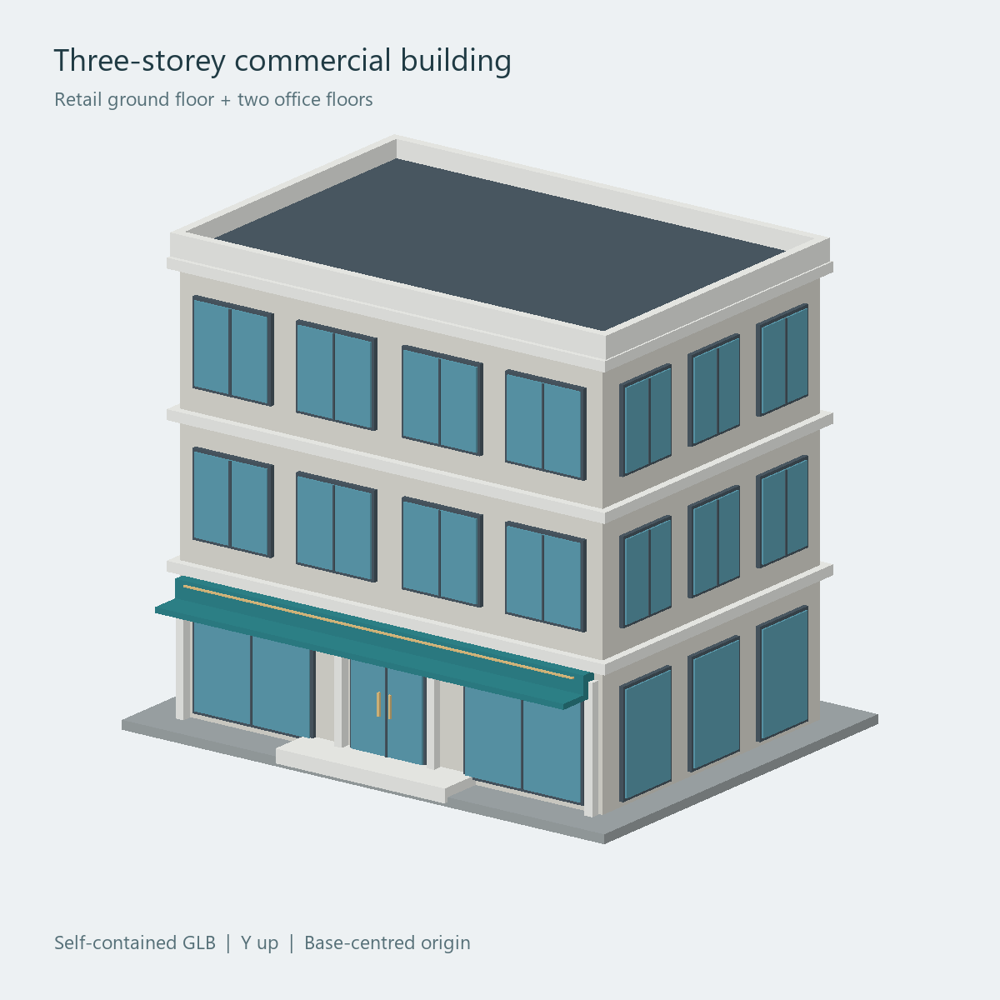

# Webarqr sample building

A small, self-contained **three-storey commercial building** for testing a mobile WebAR project: a retail ground floor, two office floors, blue windows, an entrance canopy, and a flat roof.



## Get the model

- [sample-building.glb](outputs/sample-building.glb) — open the file and use GitHub's **Download raw file** button.
- [sample-building.zip](outputs/sample-building.zip) — includes the GLB, preview, validation report, and usage notes. Download the raw ZIP, then extract it.

The GLB includes its geometry and materials. No external textures or companion files are required.

## Model details

| Property | Value |
| --- | --- |
| Format | Binary glTF 2.0 (`.glb`) |
| Storeys | 3 |
| File size | 95,176 bytes (about 93 KiB) |
| Triangles | 1,668 |
| Vertices | 3,336 |
| Materials / primitives | 7 |
| Overall dimensions | 11.4 m wide × 9.9 m high × 8.8 m deep |
| Coordinates | Y up; front faces +Z |
| Origin | Base centre |
| External resources | None |

Start with a uniform scale of `0.08` for a model approximately 0.91 metres wide. The orientation and placement relative to an image marker must be configured in the consuming WebAR application.

## Folder analysis

This repository contains the sample asset and its generation tools. It does **not** yet include a MindAR web application, compiled image target (`.mind`), camera flow, or GitHub Pages deployment setup.

| File | Purpose |
| --- | --- |
| `outputs/sample-building.glb` | Ready-to-use building model |
| `outputs/sample-building-preview.png` | Orthographic preview generated from the same geometry |
| `outputs/sample-building-validation.json` | Khronos validator report |
| `outputs/sample-building.zip` | Download bundle |
| `outputs/build_sample.py` | Generates the model and preview |
| `outputs/validate_glb.cjs` | Validates the GLB and updates the report |
| `outputs/package_sample.py` | Creates and checks the download bundle |
| `outputs/README.txt` | Usage notes included in the bundle |

Synced project references, machine-specific context, installed packages, and local caches are excluded from version control.

## Generate, validate, and package

Install Python 3.10+ and Node.js 18+ with npm. In the repository folder:

```sh
python -m pip install -r requirements.txt
npm ci
npm run build
npm run validate
npm run package
```

Use `python3` in place of `python` where your system requires it; the Python scripts can also be run directly. The generator uses a system font when available and falls back to Pillow's bundled font.

The GLB is checked with the [official Khronos glTF Validator](https://github.com/KhronosGroup/glTF-Validator). The checked-in model has **zero errors and zero warnings**. Validation exits with a failure status if either is found. Packaging also checks the GLB header, report freshness, and ZIP integrity.

The preview approximates material colours; lighting in an AR viewer may differ.
